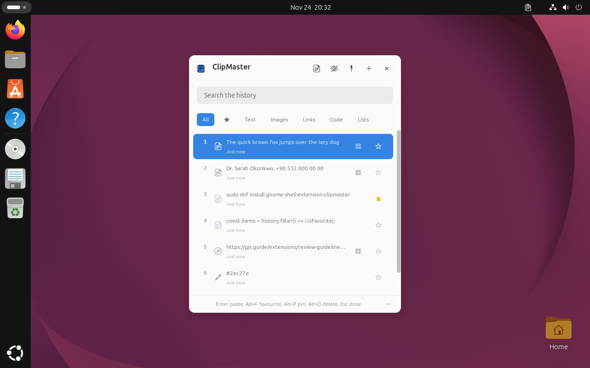

# ClipMaster

A clipboard history for GNOME Shell. Everything it stores stays on your machine: there is no network code in it and nothing is sent anywhere.



<a href="https://www.buymeacoffee.com/sfnemis" target="_blank"></a>
[](https://ko-fi.com/Y8Y01PIT77)

Install it from [extensions.gnome.org](https://extensions.gnome.org/extension/8923/clipmaster/).

Supports GNOME Shell 46 to 51, on Wayland and on X11.

## What it does

- Keeps a history of text, links, colours, code and images, with thumbnails
- Search, favourites, pinned items and custom lists
- Private mode, so nothing is recorded while you are doing something you would rather not keep
- A per application exclusion list, for password managers and anything else that should never be recorded
- Shows any entry as a QR code, which is the quickest way to get a link onto a phone
- Twelve themes, or it follows your system light and dark setting
- Resize the popup by dragging its corner, or open it at a fixed spot on the screen

## Keyboard

ClipMaster does not come with a keyboard shortcut. The GNOME Extensions review guidelines do not allow an extension that reads the clipboard to claim one, and the two that earlier versions used were already taken anyway: `Super+V` opens the notification list and `Ctrl+Shift+V` is how you paste in a terminal. Pick your own on the Shortcuts page of the preferences.

Once the popup is open:

| Key | Action |
|-----|--------|
| `↑` `↓` | Move through the list |
| `1` to `9` | Pick that entry straight away |
| `Enter` | Paste the selected entry |
| `Alt+F` | Favourite |
| `Alt+T` | Plain text mode |
| `Alt+P` | Keep the popup open |
| `Alt+D` | Delete |
| `Esc` | Close |

Typing anything else searches.

## Privacy

Private mode stops recording entirely. Turn it on from the panel menu, from the popup, or with a shortcut if you set one. The panel icon changes while it is on.

The exclusion list names applications whose copies are never recorded. An entry matches the application id, its name or its window class, so `KeePassXC`, `org.keepassxc.KeePassXC` and `keepassxc` all work. Content copied from an excluded application is refused if it turns up again later too, which is what happens when that application closes and hands the clipboard over.

### About the "obfuscate" setting

ClipMaster can scramble its history file so that the text is not readable at a glance, by a search tool, a backup indexer or a file preview. The key sits next to the data, because the extension has to read the history back without asking you for anything, so whoever can read the file can recover what is in it. It is obfuscation. Versions up to 1.3.1 called it AES-256 in the preferences window, which was wrong.

GNOME Shell extensions have no cipher available in the libraries the shell already loads, and the review guidelines discourage calling out to one, so that is as far as it goes. For anything that has to stay secret, use private mode or the exclusion list.

## Installing from a clone

```bash
git clone https://github.com/sfnemis/ClipMaster.git
cd ClipMaster
./install.sh
```

Then log out and back in, and enable it:

```bash
gnome-extensions enable clipmaster@gnome.extension
gnome-extensions prefs clipmaster@gnome.extension
```

There is nothing else to install. This file used to ask for `wl-clipboard` and `xclip` for image pasting, so you can remove them if you installed them for ClipMaster: no version has ever called either one.

## Where things are kept

| What | Where |
|------|-------|
| History | `~/.local/share/clipmaster/clipboard.json` |
| Images | `~/.local/share/clipmaster/images/` |
| Obfuscation key | `~/.local/share/clipmaster/clipboard.key` |
| Settings | `dconf`, under `/org/gnome/shell/extensions/clipmaster/` |

The history file and the key are created readable by you only. A backup of the previous history is kept beside it as `clipboard.json.bak`.

If the history file cannot be read, ClipMaster stops writing rather than starting a fresh one over the top, keeps a copy of the unreadable file next to it and tells you. Version 1 replaced it, which is how people lost their history.

## Development

```bash
npm install eslint         # once
npx eslint .               # lint
gjs -m tests/run-tests.js  # unit tests, on a machine with GNOME
bash scripts/build.sh      # build the published zip
```

`scripts/live-test.sh` and `scripts/live-ui-test.sh` run against a real GNOME session. The second one needs the development harness in `scripts/test-harness`, which should only ever go on a throwaway virtual machine; read its README first.

## License

GPL-2.0-or-later. The QR encoder is derived from Project Nayuki's library and keeps its MIT notice.
